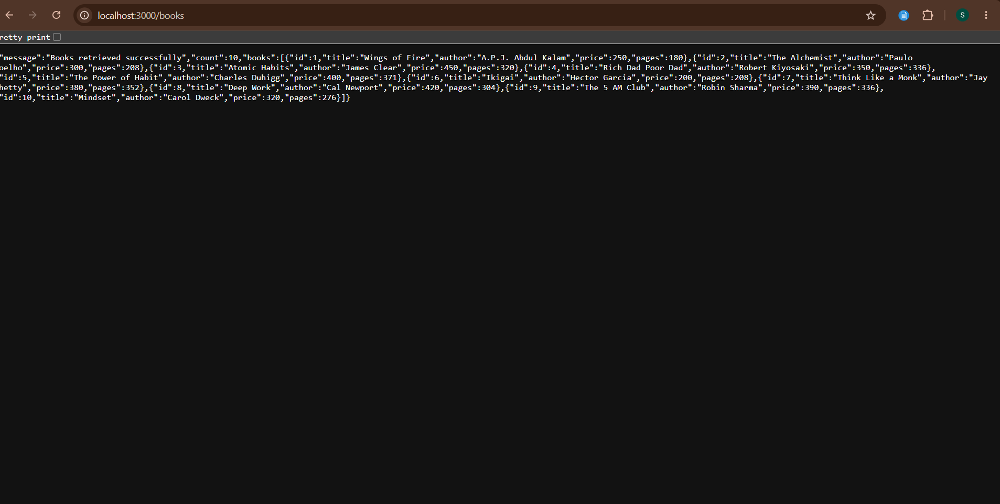
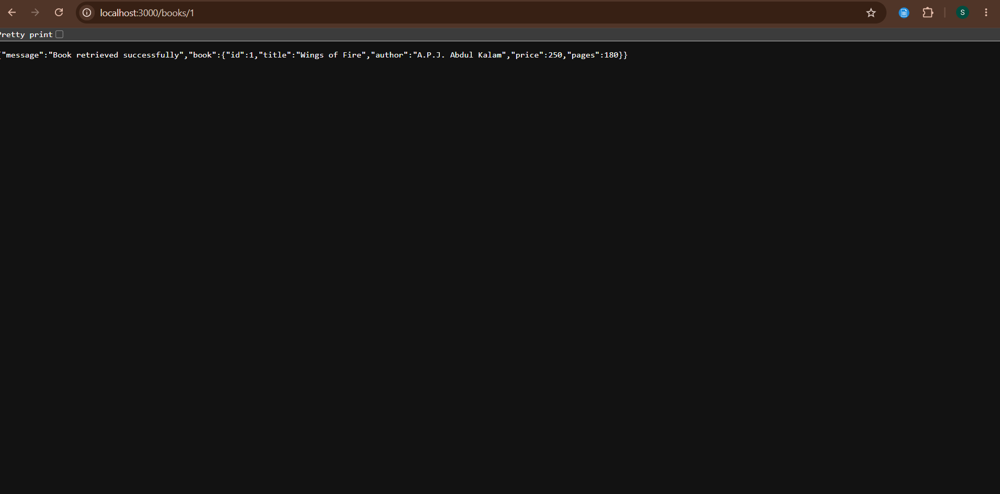
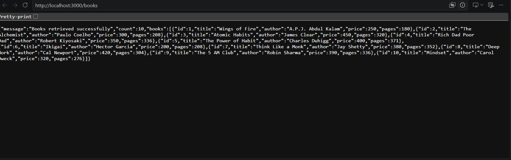
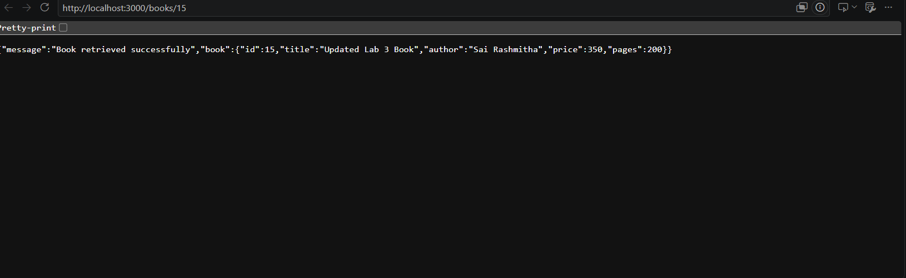
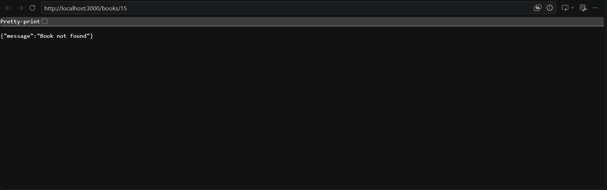
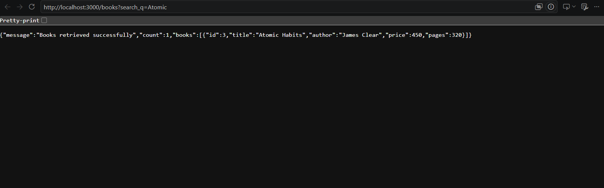
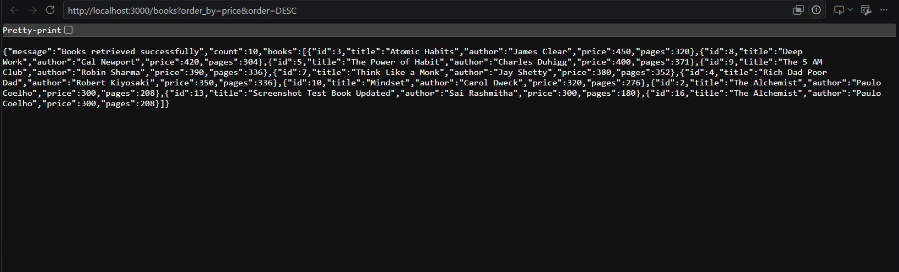
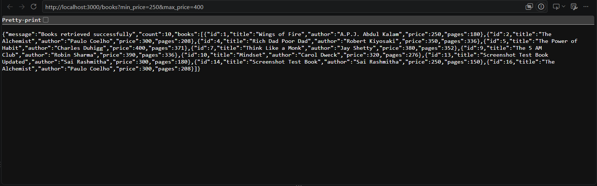
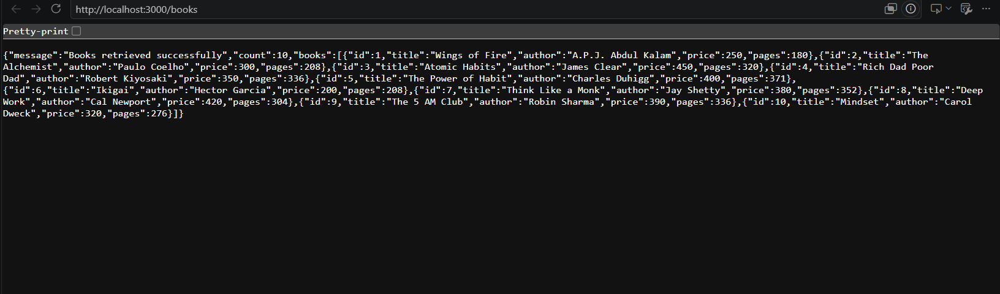

# Lab 03 – REST API, Query Parameters, Validation and Debugging

## Student Details

- **Name:** D.Mahesh
- **Registration Number:** 252U1R9034
- **Section:** CSE (Gen-AI) 2A
- **University:** Aurora Deemed to be University
- **Course:** Backend Development Fundamentals
- **Year:** II
- **Term:** II
- **Faculty:** Mr.D. Joel Prashanth

## Project Description

This project implements a RESTful Book Management API using Node.js, Express.js and SQLite.

The API supports creating, retrieving, updating and deleting books. It also includes search, sorting, pagination, price filtering and input validation.

## Technologies Used

- Node.js
- Express.js
- SQLite
- JavaScript
- Nodemon
- PowerShell for API testing

## Project Structure

```text
Lab-03-REST-API/
│
├── app.js
├── database.js
├── package.json
├── package-lock.json
├── README.md
├── .gitignore
└── screenshots/
    ├── get-all-books.png
    ├── post-create-book.png
    ├── put-update-book.png
    └── delete-book.png
```

## Installation and Setup

1. Install Node.js.
2. Open the project folder in VS Code.
3. Install dependencies:

```powershell
npm.cmd install
```

4. Start the server:

```powershell
node app.js
```

For development:

```powershell
npx.cmd nodemon app.js
```

Server URL: `http://localhost:3000`

The SQLite database and book table are initialized automatically when the server starts.

## API Endpoints

| Method | Endpoint | Description | Status |
|---|---|---|---|
| GET | /books | Retrieve all books | 200 |
| GET | /books/:id | Retrieve a book by ID | 200 |
| POST | /books | Create a new book | 201 |
| PUT | /books/:id | Update a book | 200 |
| DELETE | /books/:id | Delete a book | 200 |

## Query Parameters

The GET `/books` endpoint supports:

- `search_q` – Search books by title.
- `order_by` – Sort by id, title, author, price or pages.
- `order` – ASC or DESC.
- `limit` – Number of books to retrieve.
- `offset` – Number of records to skip.
- `min_price` – Minimum book price.
- `max_price` – Maximum book price.

Examples:

```text
http://localhost:3000/books?search_q=Atomic
http://localhost:3000/books?order_by=price&order=DESC
http://localhost:3000/books?limit=3&offset=0
http://localhost:3000/books?min_price=250&max_price=400
```

## Validation and Error Handling

- Validates required title and author fields.
- Rejects missing or non-numeric prices.
- Validates positive integer page counts.
- Returns HTTP 400 for invalid input.
- Returns HTTP 404 when a book does not exist.
- Uses consistent JSON error messages.
- Uses parameterized SQL queries.

## Testing Performed

The following tests were performed using PowerShell `Invoke-RestMethod`:

1. Retrieve all books.
2. Search books by title.
3. Sort books in ascending order.
4. Sort books in descending order.
5. Filter books by price range.
6. Test pagination using limit and offset.
7. Create a new book.
8. Test missing author validation.
9. Test non-numeric price validation.
10. Retrieve a book by ID.
11. Update an existing book.
12. Delete a book.
13. Verify deleted book returns 404.
14. Test deletion of a non-existing book.
15. Test invalid price range.

**Testing Result:** All listed tests passed.

## Debugging Exercises

- **EADDRINUSE:** Stop the process using the occupied port or use another port.
- **Wrong import path:** Check the database file path in the require statement.
- **Table-name typo:** Ensure the table name is consistent in SQL queries.
- **Missing await:** Use `await` when executing asynchronous database operations.

## Screenshots

### 1. Get All Books


### 2. Get Single Book


### 3. Add Book - Wings of Fire


### 4. Add Book - The Alchemist


### 5. Update Book


### 6. Delete Book


### 7. Search Books


### 8. Sort Books


### 9. Pagination


### 10. Price Range Filter


### 11. Validation Error


## Deployment

The project is currently tested locally and has not yet been deployed online.

## Conclusion

This lab helped me understand REST API development using Node.js, Express.js and SQLite. I learned how to implement CRUD operations, query parameters, sorting, pagination, validation and error handling. I also practised debugging common backend development errors.